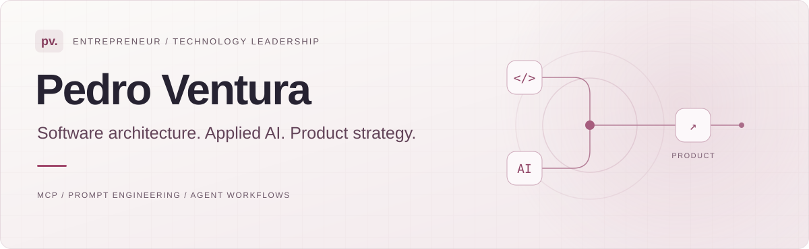

  

I'm Pedro, an entrepreneur and technology professional based in Spain.

I've worked in software development since 2008, with a career spanning hands-on engineering, technical leadership and product strategy. My current work focuses on software architecture and applied AI: building integrations, tools and workflows that connect AI capabilities with real business needs.

## Technical expertise

<picture>
  <source media="(max-width: 620px)" srcset="assets/expertise-mobile.svg" />
  
</picture>

  
<strong>Full technical scope</strong>

- **MCP development &amp; integrations.** I build custom Model Context Protocol servers that connect AI assistants to APIs and business systems, with authenticated access, scoped tools, audit trails and safeguards against duplicate operations.
- **Prompt engineering &amp; multimodal AI.** I design structured prompts and reusable context for text, vision, image, video and audio generation, including music. I connect generation with scripting, audiovisual composition and quality review.
- **Multi-agent orchestration &amp; skills.** I design reusable skills and coordinated agent workflows that take a specification through implementation, testing, documentation and delivery, with explicit responsibilities and verifiable results.
- **Data engineering, search &amp; personalisation.** I work with SQL data models, migrations and multilingual catalogues, connecting natural-language search, recommendation systems and personalised experiences to structured product data.
- **Cloud architecture &amp; production security.** I build serverless and event-driven services with OAuth authentication, scoped runtime identities, controlled data access and operational observability.
- **Analytics &amp; business automation.** I connect product analytics, search visibility and app-store performance data to decisions and automated content workflows, integrating data sources and publication systems.
- **Product delivery &amp; technical leadership.** I lead architecture and delivery across mobile, backend and cloud, including data synchronisation, subscriptions, localisation and iOS/Android release validation, aligning technical work with business priorities.

## Technologies & tooling

**AI &amp; developer tooling**

  
  
  
  
  
  
  
  
  

**Cloud &amp; data**

  
  
  
  
  
  

**Application development**

  
  
  
  

  
<strong>Broader experience &amp; toolkit</strong>

   

  <strong>🤖 Applied AI &amp; Generative Models</strong> 
  <code>Prompt Engineering (LLMs &amp; Multimodal)</code> | <code>Vertex AI (Gemini, Generative Models)</code> | <code>OpenAI APIs (Text &amp; Vision Models)</code> | <code>Image Generation &amp; Visual Models</code>
   
  <code>AI-driven Content Generation</code> | <code>Semantic Search &amp; Embeddings</code> | <code>Model Orchestration &amp; Caching</code> | <code>AI Cost Optimization &amp; Token Management</code>

    
  <strong>💻 Programming Languages</strong> 
  <code>Python</code> | <code>PHP</code> | <code>JavaScript</code> | <code>Dart</code> | <code>Bash</code>

    
  <strong>📱 Frontend &amp; Mobile</strong> 
  <code>Flutter</code> | <code>HTML5</code> | <code>Bootstrap</code> | <code>jQuery</code> | <code>AJAX</code>

    
  <strong>⚙️ Backend</strong> 
  <code>Node.js</code> | <code>Firebase (Cloud Functions, Firestore)</code> | <code>CakePHP</code> | <code>Phalcon</code>

    
  <strong>🗄️ Databases</strong> 
  <code>Google BigQuery</code> | <code>MySQL</code> | <code>SQL Server</code> | <code>SQLite</code> | <code>NoSQL</code>

    
  <strong>☁️ Cloud &amp; Infrastructure</strong> 
  <code>Google Cloud Platform (GCP)</code> | <code>Amazon Web Services (AWS)</code> | <code>Microsoft Azure</code> | <code>Vercel</code> | <code>DigitalOcean</code> | <code>Nginx</code> | <code>Apache</code>

    
  <strong>📰 CMS &amp; Search Engines</strong> 
  <code>WordPress</code> | <code>Sphinx</code>

    
  <strong>🔗 APIs &amp; Integrations</strong> 
  <code>Google APIs</code> | <code>Facebook API</code> | <code>Twitter API</code> | <code>JSON</code>

    
  <strong>🔒 Security &amp; Systems Administration</strong> 
  <code>Linux System Administration</code> | <code>Application Security</code> | <code>Server Hardening</code>

    
  <strong>📊 Advertising, Analytics &amp; Scraping</strong> 
  <code>Google Ads</code> | <code>Google Ad Manager (GAM)</code> | <code>Kevel</code> | <code>DV360</code> | <code>Google Analytics</code> | <code>Web Scraping</code>

    
  <strong>🔮 Innovation &amp; Emerging Technologies</strong> 
  <code>Blockchain</code> | <code>IoT</code>

  
<strong>Certifications &amp; continued learning</strong>

- **Coursera**: Google Data Analytics · Google AI Essentials · Google IT Automation with Python · Blockchain Specialization (University at Buffalo) · Marketing Strategy Specialization (IE Business School)
- **MIT**: Leading Innovation
- **Microsoft Azure**: AI Fundamentals · Data Fundamentals

## Enolisa

  

As founder of **Enolisa**, I apply this expertise to an AI-powered wine platform available on iOS and Android. I lead its product vision and technical execution across mobile development, cloud services, data and AI integration.

[Explore Enolisa →](https://enolisa.com/)

---

### Let's connect

I write about software architecture, applied AI and the decisions behind building digital products.

[**PedroVentura.com ↗**](https://www.pedroventura.com/)
